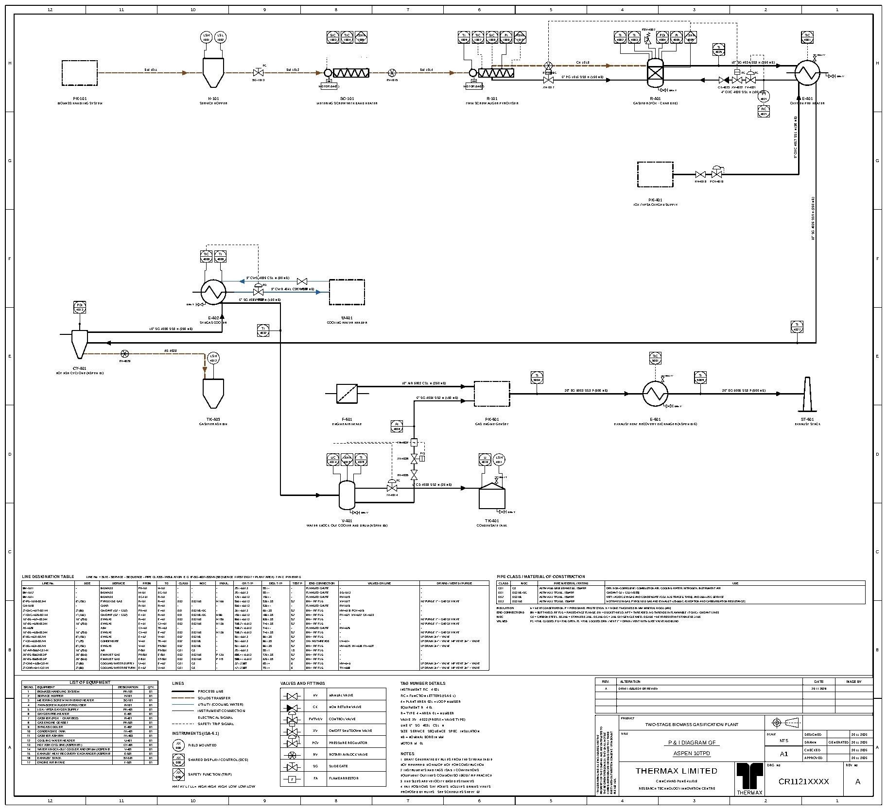
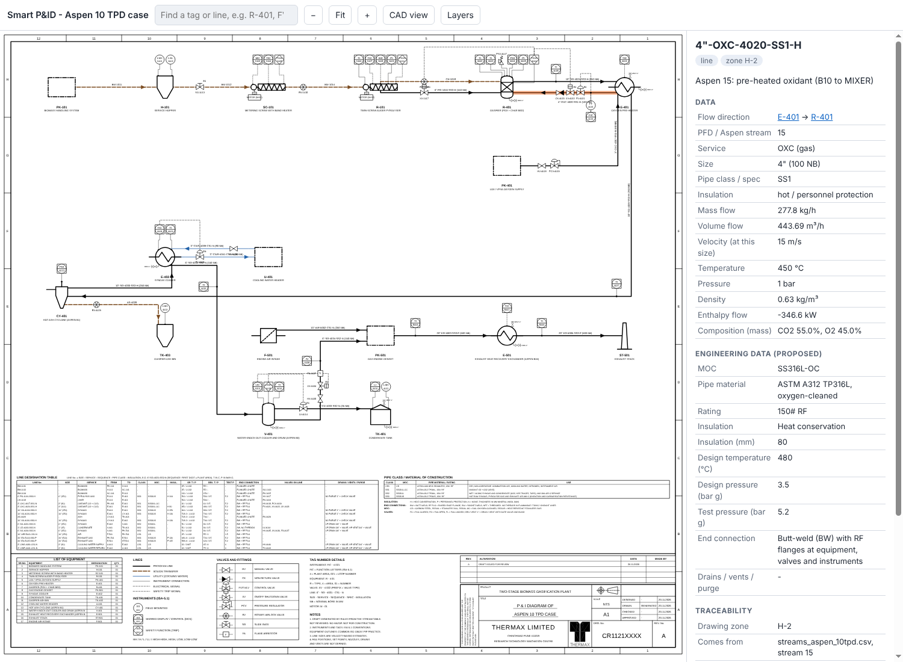

# PFD to P&ID: digitized P&ID, BOM, knowledge graph and plant assistant

A Streamlit dashboard that turns a process description held as tables (equipment and streams, typed from a PFD or
imported from Aspen Plus) into a draft P&ID and everything derived from it.

**Status: engineering draft.** Instruments and valves are added by generic rules. Nothing here has been reviewed or
been through HAZOP. Not for construction.

## Tabs in the app
| Tab | What it does |
|---|---|
| Engineering data | Line designation (line no., size, service, from / to, pipe class, MOC, insulation, design / test conditions, end connection - flanged, socket-weld or threaded -, valves, drains / vents), valve fail positions with reasons, set points / alarms / trips, nozzle schedule, drains and vents, pipe classes and abbreviations. Edit any value; AI can propose missing set points for approval. |
| Mass and energy balance | Closure of every Aspen block (mass, enthalpy, C/H/O/N), plant mass balance, corrected estimate for a real two-stage downdraft (char conversion, wall heat loss, tar, engine lambda), feedback workbook for the Aspen engineer. |
| Aspen link | Import a new HMBD workbook or a stream summary CSV, compare with the current results, or run the live COM link to Aspen Plus on a Windows PC (aspen_link.py). |
| Digital twin | Twin model JSON (asset hierarchy, lines, signals with Aspen baseline, limits and OPC UA-style node ids, relations) and signal list CSV; live rules with gap-bridging questions. |
| Challenges and gaps | What is still open (data, drawing, safety, software) with priority, next step and owner, plus live counts from this case. |
| Smart P&ID | The drawing sheet made clickable: click any item for size, nominal bore, pipe class, flow direction, flow, velocity, conditions, composition, connections, failure consequences and traceability (zone, source rule, corrections, remarks). CAD view and layer switches. Downloads: HTML, layered AutoCAD DXF of the sheet and of the legend sheet. |
| Knowledge graph | Clickable graph plus explorer: pattern queries such as `(a:instrument)-[TRIPS]->(b:valve)`, neighbours within n hops, paths. Exports for reuse: Neo4j Cypher script, GraphML, JSON, CSV. |
| Traceability | Register of every item: drawing zone, which rule or data row created it, corrections and remarks; revision log. |
| Corrections | Change the P&ID without redrafting: in-line items of a line, instruments of an equipment item, line size, valve fail position. Stored with who / when / why, re-applied on every regeneration, tag numbers stay stable. Approve or reject proposals from the copilot. |
| Review remarks | Pin a remark to any item; it shows on the sheet as a numbered flag until closed with a response. |
| BOM creation | Bill of material from the current P&ID with zones and pipe class materials; enter pipe lengths and unit costs (kept between regenerations); Excel with live formulas. |
| Copilot | Agent with tools (graph query, trace, path, failure what-if, AI model suggestions, BOM, add remark, propose correction). Commands without a key; plain-language questions with an AI key. It can only propose corrections. |
| Digitized P&ID (other views) | Drawing sheet with standard-style symbols, zone grid, equipment list, legend and title block; or a clickable viewer. SVG / HTML download. |
| Flow directions | Every line in flow direction, the process sequence, a path tracer between two items, upstream / downstream of an asset. |
| Ask the plant | Questions about assets, counts, linkage, trips, failures ("what if FV-4021 fails?") and energy. Built-in answers need no key; an AI key adds free-form answers. |
| Failure what-if | Pick an asset and a failure mode: lines losing flow, equipment losing feed, heat duty and engine power effect, protections. Whole-plant failure table. |
| AI P&ID model | Learned model that proposes valves and instruments from the PFD alone; training results; save its proposals as a new case. |
| Handover files | pid_model.json, SFILES 2.0-style strings, PID2Graph GraphML, DEXPI 1.3-style XML, knowledge graph CSV, lists. |
| Edit and regenerate | Edit the stream and equipment tables in the browser; everything regenerates. |
| New case from a PFD | Upload a PFD image or PDF; an AI model drafts the tables for you to check and save (needs an AI key). |
| Mass and energy balance | Per-equipment mass balance and the Aspen energy balance. |
| What-if: capacity | Proportional scaling of flows, duties and line sizes with feed rate. |
| Glossary and symbols | Tag conventions, ISA-5.1 letters, codes, and the symbol library. |
| DEXPI import | Optional: convert a DEXPI XML P&ID to a relations table with pyDEXPI. |

## Quick start
See **DEPLOY.md** for local run, GitHub and Streamlit Community Cloud.

    pip install -r requirements.txt
    streamlit run app.py

## How it works
    data/equipment.csv + data/streams_<case>.csv      the process as tables
            |  rules in pfd_to_pid.py                 (which instruments and valves each item gets, line sizing)
            v
    graph of equipment, lines, valves, instruments, signals
            v
    drawing sheet, clickable viewer, lists and BOM, knowledge graph, assistant context

## Files
| File | Purpose |
|---|---|
| `app.py` | The Streamlit dashboard. |
| `pfd_to_pid.py` | Rule engine: tables to P&ID model, lists, BOM. Edit `EQUIPMENT_RULES` and `HINTS` to change the rules. |
| `make_pid_sheet.py` | Draws the P&ID sheet with symbols. |
| `make_viewer.py`, `make_knowledge_graph.py` | Clickable viewer and knowledge graph pages. |
| `agent.py` | Built-in answers, AI answers, AI reading of a PFD. |
| `workflow.py` | Corrections, review remarks and revision log per case (`data/corrections_*.csv`, `reviews_*.csv`, `revisions_*.csv`). |
| `svg2dxf.py` | Writes the drawing sheet as a layered AutoCAD DXF (R12; opens in AutoCAD, DWG TrueView, LibreCAD, QCAD). |
| `kg_query.py` | Knowledge-graph pattern queries, neighbours, paths, Cypher export. |
| `bom.py` | BOM creation and Excel export (`data/bom_*.csv`, `pipe_lengths_*.csv` keep your entries). |
| `copilot.py` | Agentic copilot: tools, trained intent routing (no key) and the Claude tool-use loop (with key). |
| `copilot_nlu.py` | The copilot's trained intent model (NumPy); people can add examples and retrain in the app. Model in `models/copilot_intents.*`. |
| `copilot_kb.py` | Knowledge base: built-in MOC / maintenance / HAZOP / twin notes, case tables, Aspen review, uploaded PDFs (`data/kb/`). |
| `engineering.py` | Rules for pipe class / MOC, insulation, design conditions, end connections, fail positions, set points, nozzles, drains and vents; overrides in `data/engineering_*.csv`. |
| `balance.py` | Aspen block closure, corrected design case, feedback workbook. |
| `aspen_link.py` | Aspen results in: workbook, stream summary CSV, live COM link (Windows + Aspen Plus + pywin32). |
| `twin.py` | Digital twin model, signal list, live rules. |
| `gaps.py` | Challenges and gaps list. |
| `fetch_pid2graph.py` | Downloads the public PID2Graph dataset (Zenodo 14803338) and pre-trains the P&ID model with it (run on a PC with internet). |
| `import_aspen.py` | Reads an Aspen Plus HMBD workbook into the stream table, duties and energy tables. |
| `make_symbols.py`, `symbols/` | Symbol library (SVG) and legend. |
| `make_plant_glossary.py`, `make_dataset.py` | Plant tag glossary; synthetic PFD to P&ID dataset generator. |
| `dexpi_bridge.py` | Optional pyDEXPI link (`pip install -r requirements-optional.txt`). |
| `data/` | Equipment table, stream tables per case, Aspen workbook and derived tables, glossaries. |

## Cases included
* `streams_aspen_10tpd.csv`: from the Aspen workbook (417 kg/h biomass, O2:CO2 oxidant). Default.
* `streams_gasifier_full.csv`: PFD basis, 8.5 TPD gasifier mode, with an assumed syngas cleaning train.
* `streams.csv`, `streams_gasifier_mode.csv`, others: earlier PFD-based variants.

## Command line (without the app)
    python import_aspen.py
    python pfd_to_pid.py --streams streams_aspen_10tpd.csv --out out_aspen_10tpd
    python make_pid_sheet.py --streams streams_aspen_10tpd.csv --out out_aspen_10tpd --title "Aspen 10 TPD case"
    python make_viewer.py --out out_aspen_10tpd --title "Aspen 10 TPD case"
    python make_knowledge_graph.py --out out_aspen_10tpd --title "Aspen 10 TPD case"
    python agent.py "How many control valves are there?"

## Limits
* Symbols are drawn from general knowledge of ISA-5.1 and common ISO 10628 / PIP practice, not from the standards
  documents. Check them against your company legend.
* Layout is automatic. The SVG can be tidied in Inkscape, Visio or draw.io.
* Line sizes are velocity-based estimates. No nozzles, drains, vents, fail positions or set points.
* The assistant is a general language model given the plant data with each question. It is not trained on the plant.
* The what-if tab scales in proportion; it does not re-run the process model.

## 12. Smart P&ID, SFILES 2.0, AI model, failure analysis, legend sheet
| File | Purpose |
|---|---|
| `make_smart_pid.py` | Clickable drawing sheet (`pid_smart.html`) and handover files (`pid_model.json`, `pid.sfiles.txt`, `pid_graph.graphml`, `pid_dexpi_style.xml`). |
| `sfiles.py` | SFILES 2.0-style encoder and decoder for the PFD and the P&ID, written from the published notation (Vogel et al., Optim. Eng. 2023). Round trip checked on both plant cases and on 2,000 random flowsheets. |
| `pid_ai.py`, `train_pid_model.py` | PFD -> P&ID model (NumPy): pre-training on the synthetic P&ID graphs in `data/synthetic_pid/`, training on generated flowsheets, fine-tuning on the 10 TPD Aspen case. Approach after Hirtreiter et al., AIChE J. 2024. |
| `failure.py` | Failure modes and consequences for every valve, instrument, motor and equipment item. |
| `make_legend_sheet.py` | Legend sheet PID-000: all symbols, ISA-5.1 letters, tag conventions. |

    python make_smart_pid.py --streams streams_aspen_10tpd.csv --out out_aspen_10tpd --title "Aspen 10 TPD case"
    python make_legend_sheet.py
    python train_pid_model.py                 # about 5 minutes on a laptop; writes models/pid_model.npz
    python sfiles.py                          # prints PFD and P&ID strings and the round-trip check

### AI model results (see models/training_report.json)
Test: the 8.5 TPD PFD-basis case, never used in training (27 streams). Mean of three seeds:

| Training | Streams exactly right, top-1 | Right within top 5 | Item F1 |
|---|---|---|---|
| Real 10 TPD plant only | 0.58 | 0.75 | 0.70 |
| Generated flowsheets only | 0.68 | 0.90 | 0.78 |
| Generated + fine-tune on 10 TPD | 0.69 | 0.96 | 0.78 |
| GraphML pre-training + generated + fine-tune | 0.69 | 0.95 | 0.78 |

Generated data does most of the work; fine-tuning adds a little at top-5; GraphML pre-training adds nothing measurable,
because those graphs carry only coarse classes (valve / instrumentation / general) and no tags. The labels of the
generated data and of the two plant cases come from engineering rules, so the model learns those rules and their
variation; it becomes useful for real design only when reviewed P&IDs are added as fine-tuning data.

### References
* Vogel, Hirtreiter, Schulze Balhorn, Schweidtmann: SFILES 2.0, an extended text-based flowsheet representation. Optimization and Engineering 24 (2023).
* Hirtreiter, Schulze Balhorn, Schweidtmann: Toward automatic generation of control structures for process flow diagrams with large language models. AIChE Journal 70 (2024).
* Goldstein et al.: pyDEXPI, a Python framework for P&IDs using the DEXPI information model (2025). github.com/process-intelligence-research/pyDEXPI
* PID2Graph dataset format (the synthetic GraphML files in data/synthetic_pid follow it).
